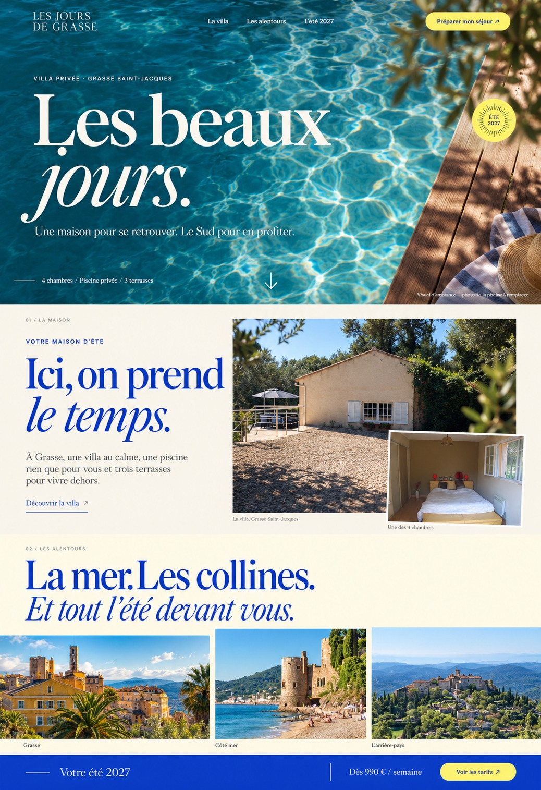

# Les Jours de Grasse

**Les beaux jours, à Grasse.**  
A home to come together. A summer to slow down.

Les Jours de Grasse is a website for a family villa available for summer stays in Grasse Saint-Jacques, on the French Riviera. Built around the feeling of holidays in the South of France, it brings together the house, its outdoor spaces, nearby escapes and seasonal pricing in one considered experience.

The goal: help families imagine their stay, understand the practical details and get in touch with the owner directly.

## Creative direction

An immersive, photography-led composition inspired by Mediterranean summers: turquoise water, warm ivory, Riviera blue and small touches of lemon yellow. Large editorial typography gives the page its rhythm, while the interface stays simple and welcoming.

The approved concept is **“Les beaux jours”**.



The concept image is a design reference. Its photography is generated or reinterpreted and must be replaced with approved originals before launch. See [Design & assets](docs/DESIGN.md).

## Highlights

- **A home for summer** — four bedrooms, a private pool, three terraces and a garden.
- **A sense of place** — Grasse, the Mediterranean coast and the surrounding hilltop villages.
- **Clear seasonal pricing** — the 2027 rates are structured separately from availability.
- **Direct enquiries** — the foundation supports an owner contact link once confirmed; form delivery is a later milestone.
- **A considered interface** — responsive structure, local fonts, accessible navigation and reduced-motion support.
- **A maintainable foundation** — typed content, shared design tokens and automated checks.

## Current status

**Development foundation — not launched.** The repository includes a working initial homepage, the approved mockup, content and price data, shared styles, metadata, tests and CI configuration. The initial homepage establishes structure and typography; the full photographic layout and animations are still to be implemented.

No reservation is accepted and no message is sent by this starter. No database, payment service, admin area or external email integration is required to run it.

## Tech stack

| Layer       | Technologies                                       |
| ----------- | -------------------------------------------------- |
| Application | Next.js 16 App Router, React 19, TypeScript        |
| Interface   | Tailwind CSS 4, custom design tokens, Lucide icons |
| Typography  | Locally bundled Cormorant Garamond and DM Sans     |
| Images      | Next.js image tooling, Sharp; final assets pending |
| Quality     | ESLint, Prettier, strict TypeScript, Vitest        |
| Development | Node.js 24, npm 11, GitHub Codespaces              |
| Automation  | GitHub Actions, Dependabot                         |

## Run locally

Requirements: **Node.js 24** and **npm 11**. With nvm, use `nvm install` followed by `nvm use`. If your Node installation bundles a different npm major, install npm 11 with `npm install --global npm@11`.

```bash
git clone https://github.com/nolhancolas-ctrl/les-jours-de-grasse.git
cd les-jours-de-grasse
npm ci
npm run dev
```

Open [localhost:3000](http://localhost:3000).

The default configuration works without an environment file. To override it, copy `.env.example` to `.env.local` (`Copy-Item .env.example .env.local` in PowerShell, or `cp .env.example .env.local` on macOS/Linux).

| Variable         | Purpose                                    | Default                 |
| ---------------- | ------------------------------------------ | ----------------------- |
| `SITE_URL`       | Canonical base URL                         | `http://localhost:3000` |
| `SITE_INDEXABLE` | Enable search indexing after launch review | `false`                 |
| `CONTACT_EMAIL`  | Confirmed owner email for the contact link | Unset                   |

Keep credentials and private values out of Git. Search indexing is off by default and also requires an HTTPS URL.

## GitHub Codespaces

Open the repository’s **Code → Codespaces → Create codespace on main**. The dev container installs Node 24 tooling and project dependencies automatically. Then run:

```bash
npm run dev
```

Port 3000 is forwarded for preview. Creating a Codespace is optional; none is provisioned automatically by this repository.

## Commands

| Command                | Purpose                                                       |
| ---------------------- | ------------------------------------------------------------- |
| `npm run dev`          | Local development                                             |
| `npm run check`        | Lint, generated route types, TypeScript, tests and formatting |
| `npm run build`        | Production build                                              |
| `npm start`            | Serve an existing production build                            |
| `npm test`             | Content integrity tests                                       |
| `npm run test:watch`   | Watch tests while developing                                  |
| `npm run format`       | Format project files                                          |
| `npm audit --omit=dev` | Audit runtime dependencies                                    |

The CI workflow runs checks and a production build on pushes to `main` and pull requests. Dependabot proposes dependency updates; it does not merge them automatically.

## Project structure

```text
src/app/          Pages, metadata, robots, sitemap and global styles
src/components/   Shared interface components
src/content/      Verified villa details, surroundings and seasonal rates
src/lib/          Site configuration
public/images/    Approved production images, to be supplied
docs/design/      Approved visual reference
docs/             Design notes, roadmap and launch checklist
.devcontainer/    Codespaces development environment
.github/          Quality workflow, dependency updates and PR template
```

## Before launch

The [roadmap](docs/ROADMAP.md) records the next steps: integrate original photography, implement the approved composition and motion, confirm capacity and stay conditions, configure the contact flow, then validate and deploy.

Important content distinctions:

- The **7–21 August 2027** period has no supplied price; it is shown as “Nous consulter”.
- Prices do not confirm availability. No live availability calendar is connected.
- Multiple-week reductions have no supplied percentage.
- Maximum occupancy, exact travel times, possible fees and owner contact details require confirmation.

The project is compatible with standard Next.js hosting, including Vercel. Hosting, a domain and external services have not been provisioned. See [Deployment](docs/DEPLOYMENT.md).

---

Designed & developed by **Nolhan Colas** · [GitHub](https://github.com/nolhancolas-ctrl)  
Photography and creative assets belong to their respective rights holders. No open-source licence is granted by this repository.
